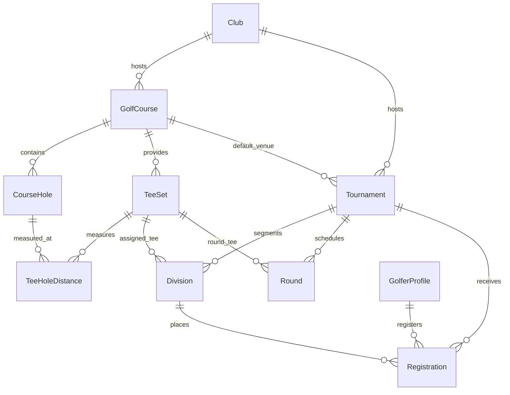

# GolfPulse — Core Golf Domain Schema Design Document

**Document Version:** 1.0.0  
**Phase:** Phase 3 — Core Golf Database Foundation  
**Workspace:** `G:\golf`  
**Prisma Version:** 5.22.0  
**Target Database:** Neon PostgreSQL Serverless (`neondb`)  
**Applied Migration:** `20261016130604_add_core_golf_domain`

---

## 1. Domain Overview & Modeling Philosophy

The GolfPulse tournament platform requires a relational foundation capable of modeling real-world golf competition operations:
1. Multi-club and multi-course flexibility (e.g. clubs with multiple 18-hole courses or shared tournament venues).
2. World Handicap System (WHS) hole and tee rating attributes (Course Rating, Slope Rating, Stroke Index, Par).
3. Tournament lifecycle state machine (Draft ➔ Published ➔ Registration Open ➔ Registration Closed ➔ In Progress ➔ Scoring Review ➔ Finalized / Cancelled).
4. Golfer identity isolated from administrative access control.
5. Registrations with distinct registration status vs. payment status and immutable financial/handicap historical snapshots.

---

## 2. Entities & Schema Architecture

### A. Club
- **Role:** Represents a golf club, country club, or tournament organizing body.
- **Fields:**
  - `id`: `String` (CUID primary key).
  - `name`: `String` — Full official club name.
  - `slug`: `String` (Unique) — SEO-friendly URL identifier (e.g. `prestige-golfshire-club`).
  - `description`: `String?` (Postgres `TEXT`) — Long-form overview.
  - `address`, `city`, `state`, `country`, `postalCode`: Location details (`country` defaults to `"India"`).
  - `phone`, `email`, `website`: Contact coordinates.
  - `timeZone`: `String` (Defaults to `"Asia/Kolkata"`).
  - `isActive`: `Boolean` (Indexed).
  - `heroImageUrl`, `logoUrl`: Media references.
  - `createdAt`, `updatedAt`: Audited timestamps.

### B. GolfCourse
- **Role:** Specific golf course venue. A Club can own multiple 18-hole courses (e.g. "Championship Course", "Resort Course").
- **Fields:**
  - `id`: `String` (CUID).
  - `clubId`: `String?` — Foreign key to `Club` (SetNull on delete, allowing shared or municipal arrangements).
  - `name`, `slug`: Course name and unique slug.
  - `holesCount`: `Int` (Default: 18).
  - `par`: `Int` (Default: 72).
  - `timeZone`: Course local time zone.

### C. CourseHole & TeeSet
- **CourseHole:**
  - Represents individual holes 1 through 18.
  - Composite Unique Constraint: `@@unique([courseId, holeNumber])` prevents duplicate holes per course.
  - `par`: Hole par (typically 3, 4, or 5).
  - `strokeIndex`: Hole difficulty handicap index (1 through 18).
- **TeeSet:**
  - Color and tee configurations (e.g. Championship Gold, Blue, White, Red).
  - `courseRating`: `Decimal(4, 1)` (e.g. 74.2 — score expected for a scratch golfer in normal conditions).
  - `slopeRating`: `Int` (Standard integer from 55 to 155; USGA/WHS measurement of relative difficulty for a bogey golfer).
  - `gender`: `GenderCategory` enum (`MEN`, `WOMEN`, `ALL`).
- **TeeHoleDistance:**
  - Specific yardage/meter measurement from that tee set to that hole pin green: `@@unique([teeSetId, holeId])`.

### D. Tournament
- **Role:** Central competitive event entity.
- **Enums:**
  - `TournamentFormat`: `STROKE_PLAY`, `STABLEFORD`, `MATCH_PLAY`, `SCRAMBLE`, `BETTER_BALL`.
  - `TournamentAccess`: `PUBLIC`, `MEMBERS_ONLY`, `INVITATIONAL`.
  - `TournamentStatus`: `DRAFT`, `PUBLISHED`, `REGISTRATION_OPEN`, `REGISTRATION_CLOSED`, `IN_PROGRESS`, `SCORING_REVIEW`, `FINALIZED`, `CANCELLED`.
- **Financial & Monetary Precision:**
  - `entryFee`: `Decimal(10, 2)` — Exact currency value avoiding floating-point rounding errors.
  - `currency`: `String` (Default: `"USD"`).
- **Field & Capacity:**
  - `fieldCapacity`: Total participant limit.
  - `registrationOpenAt`, `registrationCloseAt`: Explicit cutoff timestamps.
  - `handicapRequired`: `Boolean`.
  - `maxHandicapLimit`: Optional index threshold (`Decimal(4, 1)`).

### E. Division & Round
- **Division:** Flight/category segmentation (e.g. "Championship Flight (Gross)", "Men's A Flight (0-9 HCP)", "Senior Flight"). Supports division-specific tee sets and handicap range limits.
- **Round:** Multi-day round scheduling (`roundNumber`, `roundDate`, `isScoringLive`, `isCompleted`). Unique per tournament: `@@unique([tournamentId, roundNumber])`.

### F. GolferProfile
- **Role:** Player identity distinct from administrative privileges.
- **Fields:**
  - `id`: CUID.
  - `firstName`, `lastName`, `email` (Unique).
  - `handicapIndex`: `Decimal(4, 1)` (Optional WHS Handicap Index, e.g. `8.4`).
  - `handicapNetworkId`: National ID or GHIN/WHS registration number.
  - `handicapStatus`: `HandicapStatus` enum (`UNVERIFIED`, `VERIFIED`, `SELF_DECLARED`).

### G. Registration
- **Role:** Golfer tournament entry contract.
- **Enums & State Separation:**
  - `RegistrationStatus`: `PENDING`, `CONFIRMED`, `WAITLISTED`, `WITHDRAWN`, `CANCELLED`.
  - `PaymentStatus`: `UNPAID`, `PAID`, `REFUNDED`, `WAIVED`, `FREE_ENTRY`.
- **Historical Snapshots:**
  - `entryFeePaid`: Decimal snapshot of fee at time of checkout.
  - `handicapSnapshot`: Decimal snapshot of golfer's playing handicap at the close of entries (prevents retroactive score distortion if index changes).
  - `referenceNumber`: Unique alphanumeric confirmation code (e.g. `GP-2026-X89K2`).
- **Idempotency & Re-registration:**
  - Unique Constraint: `@@unique([tournamentId, golferId, status])`. A golfer cannot have duplicate active `CONFIRMED` registrations. If a registration is marked `CANCELLED` or `WITHDRAWN`, the golfer may legitimately register again with a new reference number.

---

## 3. Migration & Backward Compatibility Verification

1. **Non-Destructive Additive Verification:**
   - Migration `20261016130604_add_core_golf_domain` contains 0 `DROP TABLE` or `DROP COLUMN` statements.
   - All 8 Phase 2 administrative and media tables (`AdminUser`, `AdminSession`, `PasswordResetToken`, `MediaAsset`, `MediaSlot`, `MediaVersion`, `GalleryItem`, `MediaAuditLog`, `AdminAuditLog`) remain completely untouched.
2. **Neon PostgreSQL Live Verification:**
   - Applied via `npx prisma migrate deploy` on database `neondb` at `ep-wild-forest-b5ice8bp-pooler.c-7.us-east-2.aws.neon.tech`.
   - Verified that live records (Admin accounts, 34 media slots, 1 custom cropped asset) remain intact.
3. **Compilation:**
   - `npx prisma generate` generated typed definitions for all 8 new models and 7 enums.
   - `npm run build` completed successfully (Exit Code 0, 43 routes).
