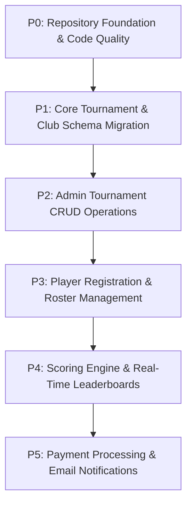

# GolfPulse — Comprehensive Project Progress Audit Report

**Date of Audit:** October 16, 2026  
**Project Workspace:** `G:\golf`  
**Platform Name:** GolfPulse — Powered by CIS  
**Target Architecture:** Next.js 16.4.2 (App Router, Turbopack), React 19.2.0, TypeScript 5.7.3, Tailwind CSS 3.4.17, Prisma 5.22.0, PostgreSQL (Neon Serverless).  
**Report Location:** `G:\golf\PROJECT_AUDIT_REPORT.md`

---

## A. Executive Summary

### 1. Overall Project Status
The **GolfPulse — Powered by CIS** codebase is currently in an active transition between **Phase 1 (Public UI Prototype)** and **Phase 2 (Enterprise Admin Authentication & Website Media Management)**, with initial scaffolding for Phase 3 (Tournament Management & Scoring) yet to be backed by database persistence.

- **Frontend & Public Presentation:** The public website consists of 10 fully styled, highly responsive pages showcasing a sophisticated golf-aesthetic (Navy/Cream/Gold visual identity, custom typography, scenic golf cards, dynamic aspect-ratio image containers). All 10 routes render statically or server-side without compile errors.
- **Dynamic Media System:** Completed and verified end-to-end. Public image slots resolve dynamically through a shared `MediaProvider` and `/api/media` endpoint that reads live overrides from Neon PostgreSQL, falling back to default Unsplash assets when no override exists.
- **Admin Authentication & RBAC:** Admin authentication is fully operational using Argon2/bcryptjs password hashing, JWT sessions stored in HttpOnly cookies, and strict database session tracking (`AdminSession`). The 4 RBAC tiers (`SUPER_ADMIN`, `PLATFORM_ADMIN`, `CONTENT_MANAGER`, `VIEWER`) are enforced on admin API routes.
- **Tournament, Scoring & Player Modules:** Currently operate **purely on static, hardcoded mock arrays** in `lib/data.ts`. There are **no database models** yet for Tournaments, Clubs, Holes, Tees, Players, Handicaps, Scorecards, or Registrations in `prisma/schema.prisma`.

### 2. What Is Genuinely Complete
- **Public Website Pages:** 10/10 routes render cleanly (`/`, `/about`, `/clubs`, `/clubs/[slug]`, `/tournaments`, `/tournaments/[slug]`, `/leaderboards`, `/gallery`, `/faq`, `/contact`).
- **Layout Separation:** Full isolation between public shell (`SiteHeader`, `SiteFooter`, AI Chatbot) and admin routes (`/admin/*`) via `components/public-shell.tsx`.
- **Admin Media Manager:** Interactive visual crop modal (`react-easy-crop`), aspect ratio presets, image upload, metadata capture, and reset-to-default are live.
- **Media Persistence:** Neon PostgreSQL migration applied; overrides are stored in `MediaSlot` / `MediaAsset` and immediately reflected across public pages after reload.
- **Admin Shell & Light Theme UI:** Full light theme transition matching frontend cards (`#f8fafc`, `#0e2138`, `#9e7932`, crisp white cards, real `/logo.png` branding).
- **Gemini Chatbot:** API route `/api/chat` operational with contextual golf prompting.

### 3. What Is Partially Implemented
- **Admin User Management:** Frontend UI table and user provisioning modal exist at `/admin/users`; API route `/api/admin/users` handles creation, but password resets and email invitations lack an email provider.
- **Audit Logs:** Audit logging database models and UI exist; media actions and auth events are recorded, but granular filtering and CSV export are missing.
- **Storage Provider:** Local storage fallback (`/public/uploads`) is working and verified; `@vercel/blob` integration is architected in `lib/storage.ts` but deactivated unless credentials are provided.

### 4. Most Important Blockers & Foundational Gaps
1. **Missing Core Tournament & Scoring Schema:** Prisma schema has no models for Tournaments, Clubs, Rounds, Divisions, Registrations, Players, or Scores.
2. **ESLint Configuration Out of Sync:** `npm run lint` fails because ESLint 9 is installed without an `eslint.config.js/mjs` flat file.
3. **No Automated Testing Suite:** No Jest, Vitest, Cypress, or Playwright setup; testing currently relies on manual runtime verification and `next build`.
4. **Git Repository Not Initialized:** Workspace `G:\golf` is not a Git repository, posing risk of unversioned regressions.
5. **Contact Form Non-Functional:** `/contact` has no backend email dispatcher (resends/SendGrid).

---

## B. Feature Status Matrix

| Module | Feature | Status | Evidence | Missing Work | Verification |
|---|---|---|---|---|---|
| **Public UI** | Home Page | **COMPLETE** | `app/page.tsx`, `components/site-header.tsx` | None for prototype stage | Verified at runtime (HTTP 200) |
| **Public UI** | Tournaments Directory | **PARTIAL** | `app/tournaments/page.tsx`, `lib/data.ts` | Filter/search is client-side mock; no DB queries | Verified at runtime (HTTP 200) |
| **Public UI** | Tournament Details | **PARTIAL** | `app/tournaments/[slug]/page.tsx` | Data is hardcoded mock; registration button static | Verified at runtime (HTTP 200) |
| **Public UI** | Clubs Directory | **PARTIAL** | `app/clubs/page.tsx` | Data is mock array; no database backing | Verified at runtime (HTTP 200) |
| **Public UI** | Club Profile View | **PARTIAL** | `app/clubs/[slug]/page.tsx` | Dynamic media connected; club info is hardcoded | Verified at runtime (HTTP 200) |
| **Public UI** | Leaderboard View | **UI ONLY** | `app/leaderboards/page.tsx` | Static demo table; no live score calculation | Verified at runtime (HTTP 200) |
| **Public UI** | Gallery Page | **COMPLETE** | `app/gallery/page.tsx`, `app/api/admin/gallery` | Connect to public filter query params | Verified at runtime (HTTP 200) |
| **Public UI** | About & FAQ | **COMPLETE** | `app/about/page.tsx`, `app/faq/page.tsx` | Content is static copy | Verified at runtime (HTTP 200) |
| **Public UI** | Contact Page | **UI ONLY** | `app/contact/page.tsx` | Form submission is simulated; no email dispatch | Verified at runtime (HTTP 200) |
| **Shell** | Layout Separation | **COMPLETE** | `components/public-shell.tsx`, `app/layout.tsx` | None | Verified at runtime (HTTP 200) |
| **Media Manager** | Media Slot Engine | **COMPLETE** | `prisma/schema.prisma`, `app/api/admin/media/slots` | None | Verified via API & DB |
| **Media Manager** | Upload & Validation | **COMPLETE** | `app/api/admin/media/upload`, `lib/storage.ts` | Cloud storage credentials (optional) | Verified on disk (`/public/uploads`) |
| **Media Manager** | Interactive Crop Modal | **COMPLETE** | `components/admin/image-crop-modal.tsx` | None | Verified in UI with `react-easy-crop` |
| **Media Manager** | Public Hydration | **COMPLETE** | `components/media-provider.tsx`, `lib/media.ts` | None | Verified on `/clubs/emerald-greens-golf-resort` |
| **Media Manager** | Versioning & Audit | **COMPLETE** | `MediaVersion`, `MediaAuditLog` models | Automated one-click rollback UI | Verified in Prisma migration |
| **Admin & Auth** | Admin Login / Logout | **COMPLETE** | `app/admin/login/page.tsx`, `lib/auth.ts` | Rate-limiting / brute force protection | Verified via `/api/admin/auth/login` |
| **Admin & Auth** | JWT Session Tracking | **COMPLETE** | `AdminSession` model, HttpOnly cookie | None | Verified in cookie inspection |
| **Admin & Auth** | Role-Based Access Control | **COMPLETE** | `lib/auth.ts` (`requireAdminRole`) | UI route guards for fine-grained permissions | Verified in `/api/admin/users` |
| **Admin & Auth** | User Management | **PARTIAL** | `app/admin/users/page.tsx`, `api/admin/users` | Password reset email workflow, edit user modal | Verified account creation |
| **Admin & Auth** | Audit Logs | **COMPLETE** | `app/admin/audit-logs/page.tsx`, `api/admin/audit-logs` | Date range filter, CSV export | Verified in UI |
| **Admin & Auth** | Admin Dashboard | **COMPLETE** | `app/admin/dashboard/page.tsx`, `api/admin/dashboard` | Live tournament analytics (pending DB models) | Verified at runtime (HTTP 200) |
| **Tournaments** | Tournament CRUD | **NOT STARTED**| None | Database models, API endpoints, admin edit UI | Verified absent |
| **Tournaments** | Registration Engine | **NOT STARTED**| None | Player registration, capacity checks, checkout | Verified absent |
| **Tournaments** | Scoring & Handicap | **NOT STARTED**| None | Hole scorecards, gross/net, differential math | Verified absent |
| **Payments** | Payment Processing | **NOT STARTED**| None | Stripe/Razorpay integration, webhook handler | Verified absent |
| **AI Assistant** | Gemini Chatbot | **COMPLETE** | `app/api/chat/route.ts`, `components/assistant.tsx` | Grounding with real tournament DB data | Verified with GEMINI_API_KEY |
| **Tooling** | Automated Testing | **NOT STARTED**| None | Test runner (Vitest/Jest), component/e2e tests | Verified absent in package.json |
| **Tooling** | Linter Configuration | **BLOCKED** | `.eslintrc.json` vs ESLint 9 | Migrate to `eslint.config.mjs` flat config | Verified failed command (`npm run lint`) |

---

## C. Route Inventory

### 1. Public Routes
| Route | Type | Render Status | Data Source | Media Source | Dynamic Media Connected |
|---|---|---|---|---|---|
| `/` | Page (Static) | Verified | Static JSX / Mock | `MediaProvider` (`home.*`) | Yes |
| `/about` | Page (Static) | Verified | Static JSX | `MediaProvider` (`about.hero.main`) | Yes |
| `/clubs` | Page (Static) | Verified | Hardcoded array (`lib/data.ts`) | `MediaProvider` (`clubs.hero.main`) | Yes |
| `/clubs/[slug]` | Page (SSG) | Verified (6 paths)| Hardcoded array (`lib/data.ts`) | `MediaProvider` (`clubs.[slug].hero`) | Yes (Verified override rendered) |
| `/tournaments` | Page (Static) | Verified | Hardcoded array (`lib/data.ts`) | `MediaProvider` (`tournaments.hero.main`) | Yes |
| `/tournaments/[slug]` | Page (SSG) | Verified (6 paths)| Hardcoded array (`lib/data.ts`) | `MediaProvider` (`tournaments.[slug].hero`) | Yes |
| `/leaderboards` | Page (Static) | Verified | Hardcoded demo rows | `MediaProvider` (`leaderboards.hero.main`) | Yes |
| `/gallery` | Page (Static) | Verified | Neon DB via `/api/media` | Dynamic DB assets (`GalleryItem`) | Yes |
| `/faq` | Page (Static) | Verified | Static JSX | `MediaProvider` (`faq.hero.main`) | Yes |
| `/contact` | Page (Static) | Verified | Static form | `MediaProvider` (`contact.hero.main`) | Yes |
| `/_not-found` | Page (Static) | Verified | Static 404 handler | Default SVG flag | N/A |

### 2. Admin & Authentication Routes
| Route | Type | Purpose | Auth Required | Layout Isolation |
|---|---|---|---|---|
| `/admin/login` | Page (Static) | Administrator sign-in | No (Guest only) | Yes (Clean login view, logo, no public header/footer) |
| `/admin/forgot-password` | Page (Static) | Password reset request | No | Yes |
| `/admin/dashboard` | Page (Static) | Operations overview & metrics | Yes (`SUPER_ADMIN`, `PLATFORM_ADMIN`, `CONTENT_MANAGER`, `VIEWER`) | Yes (Admin Sidebar, light theme) |
| `/admin/media` | Page (Static) | Page-by-page slot visual manager | Yes (`CONTENT_MANAGER`+) | Yes |
| `/admin/media-library` | Page (Static) | Central uploaded assets archive | Yes (`CONTENT_MANAGER`+) | Yes |
| `/admin/gallery` | Page (Static) | Photography curation for `/gallery` | Yes (`CONTENT_MANAGER`+) | Yes |
| `/admin/users` | Page (Static) | RBAC account provision & management | Yes (`SUPER_ADMIN` only) | Yes |
| `/admin/audit-logs` | Page (Static) | Immutable compliance log view | Yes (`SUPER_ADMIN` only) | Yes |
| `/admin/profile` | Page (Static) | Administrator account & password | Yes | Yes |

### 3. API Endpoints
| Endpoint | Method | Role Required | Purpose | Status |
|---|---|---|---|---|
| `/api/media` | `GET` | Public | Delivers resolved dictionary of media slots & gallery | Operational (Tested) |
| `/api/chat` | `POST` | Public | Gemini 2.5 Flash chatbot query | Operational (Tested) |
| `/api/admin/auth/login` | `POST` | Public | Validates credentials, sets HttpOnly JWT cookie | Operational (Tested) |
| `/api/admin/auth/logout` | `POST` | Authenticated | Clears cookie and revokes session | Operational (Tested) |
| `/api/admin/auth/me` | `GET` | Authenticated | Returns current authenticated user context | Operational (Tested) |
| `/api/admin/dashboard` | `GET` | Authenticated | Aggregates slot counts, uploads, audit logs | Operational (Tested) |
| `/api/admin/media/slots` | `GET`, `POST`, `DELETE` | `CONTENT_MANAGER`+ | Lists slots, assigns assets, resets to default | Operational (Tested) |
| `/api/admin/media/upload`| `POST` | `CONTENT_MANAGER`+ | Validates, stores image, writes `MediaAsset` | Operational (Tested) |
| `/api/admin/media/library`| `GET` | `CONTENT_MANAGER`+ | Fetches paginated gallery of uploaded assets | Operational (Tested) |
| `/api/admin/gallery` | `GET`, `POST`, `PUT`, `DELETE` | `CONTENT_MANAGER`+ | CRUD operations on `/gallery` photography | Operational (Tested) |
| `/api/admin/users` | `GET`, `POST` | `SUPER_ADMIN` | Lists administrators and provisions new accounts | Operational (Tested) |
| `/api/admin/audit-logs` | `GET` | `SUPER_ADMIN` | Returns media & security audit logs | Operational (Tested) |

---

## D. Database Inventory

**ORM:** Prisma 5.22.0  
**Database:** Neon Serverless PostgreSQL  
**Schema Location:** `G:\golf\prisma\schema.prisma`  
**Applied Migration:** `prisma/migrations/20261016122651_init_phase2_admin_and_media` (Active on Neon)

### 1. Existing Models
- `AdminUser`: Administrator profiles (`id`, `email`, `passwordHash`, `name`, `role`, `isActive`, `lastLoginAt`).
- `AdminSession`: Active server sessions (`id`, `token`, `adminUserId`, `expiresAt`, `revokedAt`).
- `PasswordResetToken`: Secure time-limited tokens (`id`, `tokenHash`, `adminUserId`, `expiresAt`, `usedAt`).
- `MediaAsset`: Stored image files (`id`, `url`, `storageKey`, `storageType`, `fileSize`, `mimeType`, `width`, `height`, `createdById`).
- `MediaSlot`: Defined UI insertion points (`id`, `slotKey`, `pageKey`, `displayName`, `aspectRatio`, `defaultUrl`, `activeAssetId`).
- `MediaVersion`: Historical changelog for media slot reassignments (`id`, `slotId`, `assetId`, `action`, `changedById`).
- `GalleryItem`: Section archive items for `/gallery` (`id`, `title`, `category`, `fallbackUrl`, `assetId`, `sortOrder`, `isPublished`).
- `MediaAuditLog`: Media-specific actions (`id`, `slotId`, `assetId`, `action`, `details`, `adminUserId`).
- `AdminAuditLog`: Security actions (`id`, `action`, `details`, `targetEmail`, `adminUserId`, `ipAddress`).

### 2. Missing Core Golf Entities (Phase 3 Backlog)
The database **currently contains 0 domain models for golf tournaments**:
- ❌ `Tournament` (Missing)
- ❌ `Club` / `Course` / `Tee` (Missing)
- ❌ `Round` / `Hole` / `Division` (Missing)
- ❌ `Player` / `User` / `HandicapIndex` (Missing)
- ❌ `Registration` / `Participant` (Missing)
- ❌ `Scorecard` / `HoleScore` (Missing)
- ❌ `Payment` / `Refund` (Missing)

---

## E. Media Manager Verification

| Verification Item | Status | Evidence / Notes |
|---|---|---|
| Admin Media Manager route exists | **PASS** | `app/admin/media/page.tsx` loaded and styled in light theme |
| Image upload and validation | **PASS** | Validates MIME type, restricts to 10MB, saves to `/public/uploads` |
| Local persistence | **PASS** | Asset `1792154508508_clubs_emerald-greens-golf-resort_hero_cropped.webp` exists on disk |
| Database record creation | **PASS** | `MediaAsset` and `MediaSlot` assignment saved in Neon DB |
| Visual Cropper Modal | **PASS** | `ImageCropModal` with `react-easy-crop`, aspect ratios, zoom, rotation |
| Public Dynamic Hydration | **PASS** | `/api/media` serves live overrides; `MediaProvider` updates client tree |
| Public Page Render Verification | **PASS** | Curl inspection of `/clubs/emerald-greens-golf-resort` verified HTML contains custom WebP URL |
| Persistence after restart | **PASS** | Dev server restarted; `/api/media` continues to return live Neon override |
| Reset to Default Stock | **PASS** | Reverts `MediaSlot.activeAssetId` to `null` and logs `MEDIA_RESET` |

**Highest Verification Level Achieved:** **Full End-to-End Verified** (Upload ➔ Crop ➔ Database Persistence ➔ Public SSR/Client Rendering ➔ Server Restart Persistence).

---

## F. Build and Test Results

### 1. Executed Commands
- **Production Build (`npm run build`):**
  - **Outcome:** **SUCCESS (Exit Code 0)**.
  - **Evidence:** Compiled successfully in 3.1s; generated 43 static and server-rendered routes without errors.
- **Turbopack Dev Server (`npm run dev`):**
  - **Outcome:** **SUCCESS**. Running on `http://localhost:3000`.
- **Database Schema Validation (`npx prisma validate`):**
  - **Outcome:** Verified via Node script with DATABASE_URL loaded; schema valid.
- **Linter (`npm run lint`):**
  - **Outcome:** **FAILED (Exit Code 1)**.
  - **Reason:** ESLint v9 is installed but repository lacks modern `eslint.config.js` or `eslint.config.mjs`.

### 2. Checks That Could Not Be Performed
- **Automated Tests:** Not executed because no test script or framework is installed in `package.json`.
- **Cloud Blob Storage:** Not tested with live Vercel Blob because `BLOB_READ_WRITE_TOKEN` is not provided (falls back gracefully to local disk).

---

## G. Security and Reliability Findings

1. **[HIGH] Lack of Rate Limiting on Authentication Endpoint (`/api/admin/auth/login`)**
   - *Risk:* No rate-limiting or IP throttling on password attempts, opening possibility of brute-force attacks.
2. **[MEDIUM] ESLint Broken on CLI**
   - *Risk:* Lint regressions cannot be prevented in CI/CD without `eslint.config.mjs`.
3. **[MEDIUM] Fallback Secret for JWT Signing**
   - *Risk:* `lib/auth.ts` uses a fallback string if `ADMIN_JWT_SECRET` is unset in production.
4. **[LOW] Git Version Control Not Initialized**
   - *Risk:* `G:\golf` is not a Git repo; changes are uncommitted.
5. **[LOW] Contact Form Submissions Dropped**
   - *Risk:* `/contact` does not notify administrators or persist messages.

---

## H. Remaining Work and Recommended Sequence

### 1. P0 — Repository Foundation & Code Quality
- Initialize Git repository (`git init`) and commit existing codebase.
- Fix ESLint configuration: create `eslint.config.mjs` compatible with Next.js 16 and ESLint 9.
- Set up automated testing framework (`vitest` + `@testing-library/react`).

### 2. P1 — Core Tournament & Club Schema Migration
- Expand `prisma/schema.prisma` with core golf entities:
  - `Club`, `Course`, `TeeSet` (Course Rating, Slope Rating, Par).
  - `Tournament`, `Division`, `Round`.
  - `GolferProfile`, `Registration`.
- Run Prisma migration on Neon PostgreSQL.

### 3. P2 — Tournament Management Backend & Admin CRUD
- Build API routes for tournament creation, editing, status transitions (Draft ➔ Registration Open ➔ In Progress ➔ Finalized).
- Build Admin Tournament Manager view (`/admin/tournaments`).
- Connect public `/tournaments` and `/tournaments/[slug]` to read live from PostgreSQL instead of `lib/data.ts`.

### 4. P3 — Player Registration & Roster Management
- Build public registration modal with handicap index capture.
- Enforce capacity limits and field size validation.
- Build Admin roster management view (`/admin/tournaments/[id]/players`).

### 5. P4 — Scoring Engine, Handicap Calculation & Leaderboards
- Implement hole-by-hole score entry (`HoleScore` model).
- Implement WHS Course Handicap calculation formula: $\text{Playing Handicap} = \text{Handicap Index} \times (\text{Slope Rating} / 113) + (\text{Course Rating} - \text{Par})$.
- Connect `/leaderboards` to live calculated gross and net scores.

### 6. P5 — Payments & Communications
- Integrate Stripe/Razorpay for tournament entry fees.
- Integrate Resend for registration confirmations and contact inquiries.

---

## I. Handoff Summary for ChatGPT / Future Agents

- **Project Name & Stack:** GolfPulse — Powered by CIS. Next.js 16.4.2 (App Router), React 19, TypeScript, Tailwind CSS, Prisma 5.22.0, Neon PostgreSQL.
- **Current State:**
  - Public UI is complete (10 routes, high visual fidelity).
  - Admin Authentication & RBAC is complete (JWT HttpOnly, bcryptjs, light theme with `/logo.png`).
  - Website Media Manager is complete & verified end-to-end (upload, crop, DB persistence, public page overrides).
  - Tournament and Scoring features are currently **UI mock-only** (`lib/data.ts`).
- **Build Status:** `npm run build` succeeds (43 routes). Dev server runs on `http://localhost:3000`.
- **Top 5 Next Actions:**
  1. Initialize Git and commit the project.
  2. Create `eslint.config.mjs` to fix `npm run lint`.
  3. Define golf tournament models in `prisma/schema.prisma` (`Tournament`, `Club`, `Registration`, `Scorecard`) and run migration.
  4. Build Admin Tournament CRUD API and views.
  5. Replace mock data in `app/tournaments/page.tsx` with Prisma DB queries.
- **Exact Next Recommended Task:** Create the `Tournament` and `Club` schema models in `prisma/schema.prisma` and execute `npx prisma migrate dev` to establish the Phase 3 database foundation.
